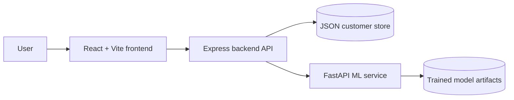

# Telecom Churn Prediction Platform

An end-to-end customer churn platform with a React dashboard, an Express API, and a FastAPI machine-learning service. It supports customer analytics, individual and CSV batch predictions, model evaluation, and Docker Compose deployment.

## Architecture



## Services

| Service | Path | Default URL | Purpose |
| --- | --- | --- | --- |
| Frontend | `frontend` | `http://localhost:5173` locally, `http://localhost` in Docker | Landing page and dashboard |
| Backend | `backend` | `http://localhost:3000/api` | Customer persistence and API gateway |
| ML service | `ml-service` | `http://localhost:8000` | Churn prediction, metrics, and analytics |

## Start the full project with Docker

Install Docker Engine and the Docker Compose plugin, then run this command from the repository root:

```bash
docker compose up --build
```

The trained model files are stored with Git LFS. On a fresh clone, make sure Git LFS is installed and the model files were downloaded before building the images (`git lfs pull`).

This builds and starts the React frontend, Express API, and FastAPI ML service. On the first run Docker downloads the base images and installs the service dependencies, so the build can take a few minutes. When it is ready, open `http://localhost`.

Use `Ctrl+C` to stop the foreground stack. To start it in the background, add `-d` and stop it later with `docker compose down`:

```bash
docker compose up --build -d
docker compose down
```

The backend customer data and uploaded CSV files are stored in Docker volumes and persist when containers stop. To remove those volumes and their data as well, run `docker compose down --volumes`.

## Run locally without Docker

Local development requires Node.js 20 LTS or newer, Python 3.11, and npm.

## Environment Setup

Create environment files from the examples when needed:

```bash
cp backend/.env.example backend/.env
cp frontend/.env.example frontend/.env
cp ml-service/.env.example ml-service/.env
```

Configure the backend `ML_SERVICE_URL` and `CORS_ORIGIN` values for your setup. The sample customer credentials in Compose are development defaults; configure secure values for any deployment that enables authentication.

## Run Locally

Start the ML service, backend, and frontend in separate terminals:

```bash
cd ml-service
python3.11 -m venv .venv
source .venv/bin/activate
python -m pip install -r requirements.txt
uvicorn app:app --reload --host 0.0.0.0 --port 8000
```

```bash
cd backend && npm install && npm start
```

```bash
cd frontend && npm install && npm run dev
```

Open `http://localhost:5173`.

## Useful Commands

```bash
# Backend syntax check
node -c backend/src/server.js

# Frontend production build
cd frontend && npm run build
```

## Repository Layout

```text
.
├── backend      # Express API and customer persistence
├── frontend     # React/Vite landing page and dashboard
├── ml-service   # FastAPI inference service and model artifacts
├── docs         # Architecture, API, EDA, and model evaluation
└── docker-compose.yml
```
